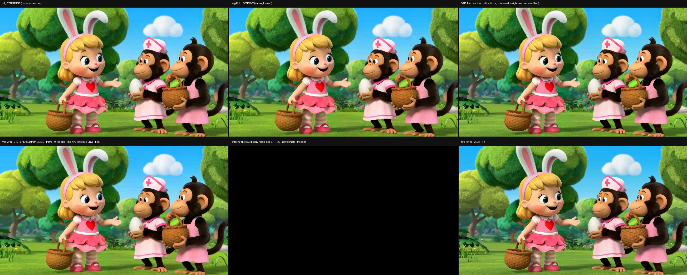

# v4g 因果流式可视化：修正后的 v2

本阶段完成样本 `VIDGEN5S_0086441` 的 **120 帧 / 24 fps / 5 秒** 对比视频。生成程序退出码为 0；原始 MP4 在服务器和本地均完整解码 120 帧，H.264 播放副本也在本地完整解码通过，均未报告错误。原 teacher 权重在推理前恢复并通过指纹核验。本页不代表 226 帧端到端验证，也不代表后续训练优化已完成。

## 对比内容

六面板依次为 v4g 逐帧流式、v4g 整段因果前向、原双向 teacher、将 latent 索引 t≥19（从 0 计数）替换为噪声、保留前 19 帧的 v4g、stream/full 的 24 通道 latent 绝对差先乘 50 并裁剪到 [0,1]、再取通道均值的灰度误差图（不是 RGB 像素误差）、HR 视频经 VAE 重建的 reference。Teacher 与 reference 的含义不同。本轮先将源视频 Lanczos 放大/裁切到 1920×1088，再用 area 缩到 1280×704 作为 LR；reference 是该 HR 的 VAE 重建。因此本轮是合成 LR 的演示，不是旧方案中生成器天然 LR 的配对评测。



- [H.264 播放版](https://github.com/RedRoman/streaming-sr-h3/releases/download/v4g-causal-viz-20261107-v2/v4g_causal_comparison_0086441_h264.mp4) · [服务器原版](https://github.com/RedRoman/streaming-sr-h3/releases/download/v4g-causal-viz-20261107-v2/causal_stream_test_VIDGEN5S_0086441.mp4)
- [阶段视频与校验和 Release](https://github.com/RedRoman/streaming-sr-h3/releases/tag/v4g-causal-viz-20261107-v2)
- 浏览器版 H.264 与原始 MPEG-4 视频保留相同的 120 帧、2888×1160、24 fps、5 秒；H.264 是有损播放副本，校验和另列。
- [Release 资产校验和](RELEASE_SHA256SUMS) · [本目录文件校验和](SHA256SUMS) · [代码包校验和](../../../code/v4g_causal_viz/SHA256SUMS)
- [实际统计](stats.json)、[验收记录](acceptance.json)、[实际配置](run_config.json)、[脱敏 manifest](manifest.public.json)、[teacher 指纹](teacher_v4g_fingerprints.json)。
- [复现代码与环境](../../../code/v4g_causal_viz/README.md)。

## 本轮实测

| 检查 | 结果 |
|---|---:|
| stream vs full 最大绝对差（latent） | 0.0006107091903686523 |
| stream vs full 平均绝对差（latent） | 0.00002633517397043761 |
| 扰动未来后，过去输出最大绝对差（latent） | 0.0 |
| 流式处理长度 | 37 latent 帧 |
| 缓存卷积数 / 最大时间长度 | 62 / 4 latent 帧 |
| 状态缓存字节数 | 1,756,385,280 |
| 原始视频完整解码 | 120 帧，exit 0 |

这些差异在历史审计使用的 0.01 阈值内。单次过去输出差异为 0 不等于对任意输入证明严格因果性。非精确零可能受数值非确定性影响；此原因尚未单独验证。没有计算新的 PSNR、SSIM 或主观质量分数。

## 修复与负结果

此前 v1 误用 v4g 权重生成 teacher 面板，并用未经验证的 latent→pixel 时间映射画切点线，不能作为最终 teacher/因果对照。保留其原视频 SHA256：`bcc32441c27d601768b53cafc350b7b9b64c260014d354a4b150544bdeb6c814`，它仍是无效的中间产物。

本轮 v2 显式恢复原 teacher，5 路均先解码并校验 uint8 RGB 形状再组图，包含此前漏解码的 reference；逐路缓存与 manifest 校验用于恢复失败作业。启动器持有设备锁至进程结束，并写独立退出记录。这里公开的是路径参数化后的代码副本，执行源码与公开源码的 SHA 分别记录，不能混用。

## 验证范围

- 本轮可视化使用 `0086441`：37 latent 解码得到 124 帧，取前 120 帧。每路 RGB 为 120×1088×1920×3，再缩放到面板尺寸。
- [历史六门审计](historical_causal_audit_0380588.json)使用另一条 holdout `0380588`，不是本轮重新执行。67 latent 检查由原 37 帧与反转尾段拼接构造，检查流式/整段等价性；没有完成独立真实 226 帧视频的解码验收。
- 历史审计实现还有边界：E1 对长短两种输入都只流式处理前 37 帧，并未完整处理 67 帧后再截前缀；F 的 `passed` 是固定 True，虽然本次三项状态观测均为 True。因此保留原 JSON/源码用于核查，不能只凭 `all_passed` 视为独立充分证明。
- 因果结论限于 upscaler 的 latent 运算，未验证整个 VAE 编解码的在线因果性、端到端延迟或实时性能。
- VAE 的逐像素时间边界未经 probe 验证，因此没有像素切点线。误差图的时间轴是 37→120 的显示重采样，不能当作精确像素时间对应。
- Teacher 指纹恢复已验证。VAE 身份只覆盖配置 SHA256、权重文件大小/mtime 与运行时路径；未哈希全部 VAE 权重内容。
- 检查了 frame060 和 H.264 首、中、末帧（0、60、119）的[抽帧拼图](video_sampled_frames_000_060_119.png)：stream/full 外观相近，末帧的未来扰动面板明显改变。仅抽查静态帧，未连续观看整片，不能据此证明整体画质提升或时间稳定性。
- 原始输入视频、v4g 推理权重、完整 VAE/teacher 权重与中间缓存未打包。复现所需外部文件和身份见代码说明、配置与 manifest；本阶段不宣称开箱即得相同结果。

后续训练优化最多三轮，每轮一个变量；每轮必须使用真实测量与相同验证条件比较，保留负结果。此目录仅记录当前基线可视化阶段。

## 播放副本复现

在 FFmpeg 7.1 中执行以下转码，再完整解码检查。原始 MPEG-4 保留供校验；H.264 CRF18 为有损副本。

```bash
ffmpeg -i causal_stream_test_VIDGEN5S_0086441.mp4 -map 0:v:0 -an -c:v libx264 -preset medium -crf 18 -pix_fmt yuv420p -movflags +faststart -map_metadata -1 v4g_causal_comparison_0086441_h264.mp4
ffmpeg -v error -xerror -i v4g_causal_comparison_0086441_h264.mp4 -f null -
```
