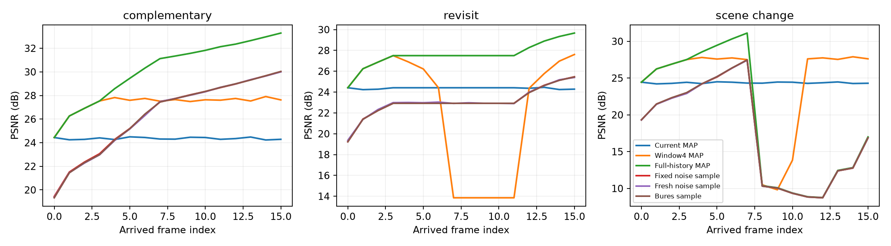
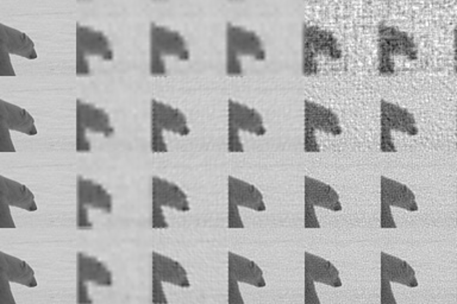

# Global blur/shift natural-patch experiment

Classical inverse-problem and posterior-coupling controls. No novel model is claimed here. Uses periodic simulation with oracle correspondence, 200 training images for spectral prior, 24 held-out source images and 64×64 patches. Seven methods × six protocols × 16 frames: 16,128 rows.

| Protocol | Current MAP | Window4 MAP | Full-history MAP | Fixed noise sample | Bures sample |
|---|---:|---:|---:|---:|---:|
| complementary | 24.286 | 27.624 | 33.289 | 30.018 | 30.036 |
| repeat_packet | 24.425 | 24.425 | 24.425 | 19.257 | 19.303 |
| independent_repeat | 24.424 | 24.509 | 24.527 | 19.330 | 19.355 |
| revisit | 24.280 | 27.607 | 29.664 | 25.468 | 25.453 |
| kernel_mismatch | 24.511 | 27.364 | 29.695 | 27.821 | 27.835 |
| scene_change | 24.295 | 27.615 | 16.998 | 16.869 | 16.867 |

Fresh resampling has 5.68× the mean squared temporal change of fixed-noise sampling in the complementary protocol. The scene is canonically static; this quantity includes valid revisions as well as unwanted drift and does not measure temporal quality of moving natural video.

Bures and fixed-noise sampling have similar final fidelity. Posterior sampling has lower PSNR than posterior mean, as expected for an uncertainty model; these simple Gaussian samples are not verified photorealistic generative detail. Hence neither posterior coupling alone nor shared noise establishes the proposed new core method.

New independent noisy repeats improve denoising slightly; copies of the same packet do not change the state. The window control refreshes an arriving duplicate but includes its evidence only once. A superseded implementation with wrong arrival handling is preserved separately and is not cited.

Scene change sharply breaks a never-forgetting ledger, while the finite window adapts. This corroborates the need for explicit revisable identities / branches; it is not grounds to abandon long-term memory.

CIs are image-bootstrap intervals over the chosen 24 source images, not evidence for all natural videos. Per-image/step metrics and cost are in per_frame.csv, complete parameters in manifest.json. The strong MAP prior is fitted only on train images.

