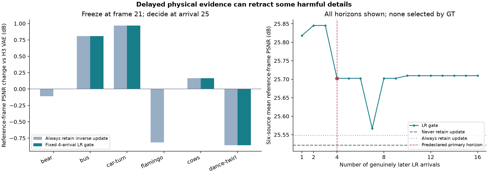

# Delayed LR validation of a frozen H3-based history update

This is a fixed classical diagnostic, not a learned core or a new compression method. All six previously used DAVIS train/val sources are included; clip-average failures were known beforehand. The primary four-arrival decision and source order were frozen before these scores or frame-21 GT metrics were read.

The existing H3 VAE context and historical inverse candidates use only frames 0–21. We freeze their frame-21 outputs, then use actual unseen LR frames 22–37. Using earlier frames inside the 22-frame VAE block as “future validation” would leak future evidence; this protocol avoids that.

For each later LR frame, the same LR-only DIS map warps the baseline and candidate. The fixed floating AA-bicubic camera predicts its observed LR. With w = confidence × 1(confidence≥0.5), score = sum w[(y−A base)^2−(y−A candidate)^2]. At arrival 25, retain the inverse candidate iff the cumulative first-four score is positive and its observable difference energy exceeds 1e−12; otherwise retain the baseline. No score threshold, source exclusion, or horizon is fitted. Scores and their SHA lock are written by a separate HR-free command before GT evaluation.

## Primary result: frozen frame 21, read at arrival 25

| State retained | Six-source PSNR | Six-source SSIM |
|---|---:|---:|
| Never apply: H3 VAE + same final DC | 25.521713 | 0.718181 |
| Always apply: historical inverse + same final DC | 25.548109 | 0.705639 |
| Fixed first-four delayed LR gate | 25.702369 | 0.718898 |

The gate improves mean PSNR by 0.180657 dB over never applying and 0.154260 dB over always applying. It gets the HR PSNR sign right on 5/6 sources. This evaluates a retrospectively retained frame-21 state after four new observations; it is not a frame-25 reconstruction or a zero-delay video output.

Splitting the pre-existing source groups, TRAIN4 base/always/gate are 25.513883/25.726789/25.958180 dB; VAL2 are 25.537373/25.190748/25.190748 dB. Thus the two validation sources still average −0.346624 dB relative to base: the positive six-source mean does not establish validation-set robustness.

| Source | Inverse PSNR gain at t21 | Retain at25? | First4 LR MSE gain | First4 observable energy | Mean valid coverage |
|---|---:|---|---:|---:|---:|
| bear | -0.111263 | no | -1.0989e-05 | 2.1866e-05 | 91.05% |
| bus | +0.806885 | yes | +4.3031e-05 | 3.0849e-05 | 78.47% |
| car-turn | +0.970304 | yes | +3.3561e-05 | 2.8433e-05 | 90.75% |
| flamingo | -0.814299 | no | -2.8379e-06 | 3.9624e-05 | 71.55% |
| cows | +0.164097 | yes | +4.3019e-06 | 2.6031e-05 | 87.52% |
| dance-twirl | -0.857346 | yes | +6.9338e-07 | 4.1799e-05 | 30.53% |

The rule retracts the harmful bear and flamingo updates and retains the useful bus, car-turn and cows updates. It incorrectly retains dance-twirl: reference PSNR falls 0.857346 dB, coverage averages only 30.53%, and the normalized score is close to zero (6.93e−7). Confidence/coverage are diagnostics, not calibrated probabilities. The actual uint8 Pillow camera, estimated motion, deformation and visibility differ from the scoring model; low reprojection error is still not a guarantee of correct detail.

## All horizons and scope

At two and three future arrivals the sign happens to be correct on 6/6 sources; those are secondary descriptive results, not substitutes for the predeclared four-arrival result. Longer horizons sometimes re-admit flamingo and reject dance-twirl. More evidence under a misspecified correspondence model is not monotonically more reliable. Frames and horizons are repeated observations of six sources, not independent samples. No statistical generalization claim or sealed-set confirmation is made.

Future-warp masked HR MSE is also retained per source/frame in evaluation.json as a secondary diagnostic. Its first-four mean gain has the same sign as the reference-frame gain for each of the six sources, including a negative gain for dance-twirl. It evaluates a different target and is not mixed with the primary reference-frame result.

## Constructive consequence

Delayed LR observations provide an actionable, imperfect signal for withholding or retracting previously proposed details. A future learned memory should preserve enough alternative evidence to reconsider an interpretation, and should distinguish insufficient evidence from verified detail. The simple score alone does not resolve model bias, nor does it establish a novel architecture. Its positive result justifies testing such revisions on actual future observations.

## Reproduction and cost

LR scoring: 0.596417s; GT evaluation: 0.597214s inside measured functions, excluding interpreter/import/hash setup where outside those timers. Four Torch CPU threads, one OpenCV thread; zero GPU, E, D, DiT or optimizer updates. Torch 2.14.1, OpenCV 5.0.0. Existing model inference and inverse-solving costs are not included in this incremental diagnostic.

`experiments/real_video_evaluation/delayed_lr_validation.py` runs `freeze`, `score`, then `evaluate` in separate commands. Protocol/source SHA, all prefix input SHA, candidate SHA, future LR SHA and LR geometry SHA are checked. No HR image is opened by the scoring phase; no sealed DIV2K source is accessed.

Protocol SHA256: `1f75680d1fd99931a19797543b8db12060858b389589a269d8e0720564051d07`.
Scores SHA256: `a9b46fc9cd1f12d95d5627fd9a1267199b3bd218c33a95eb6dfe172f1658a896`.
